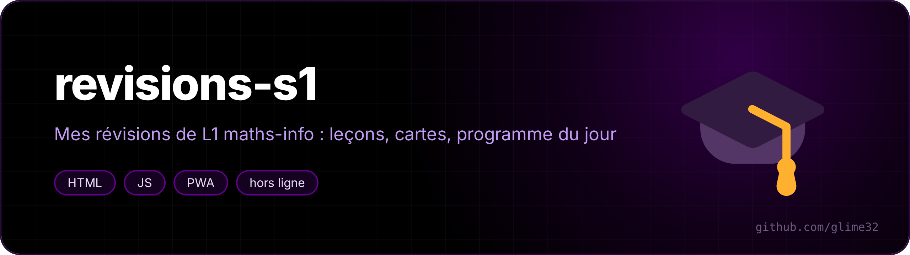
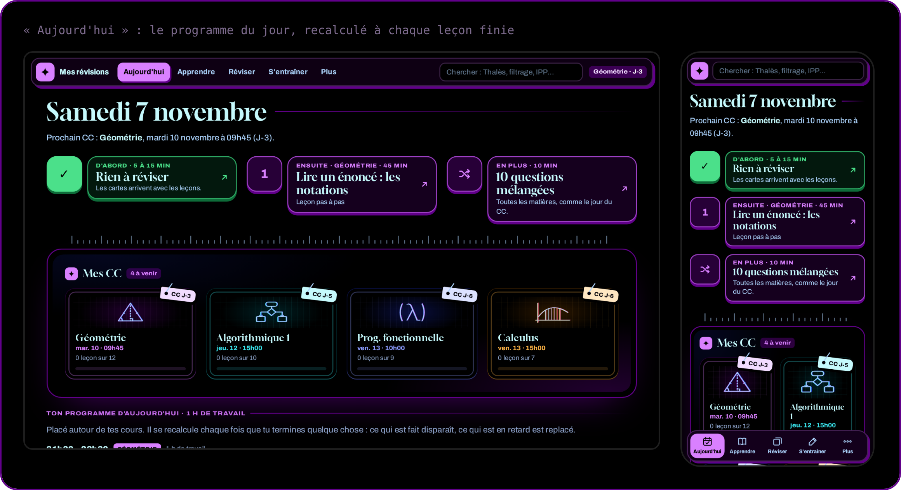
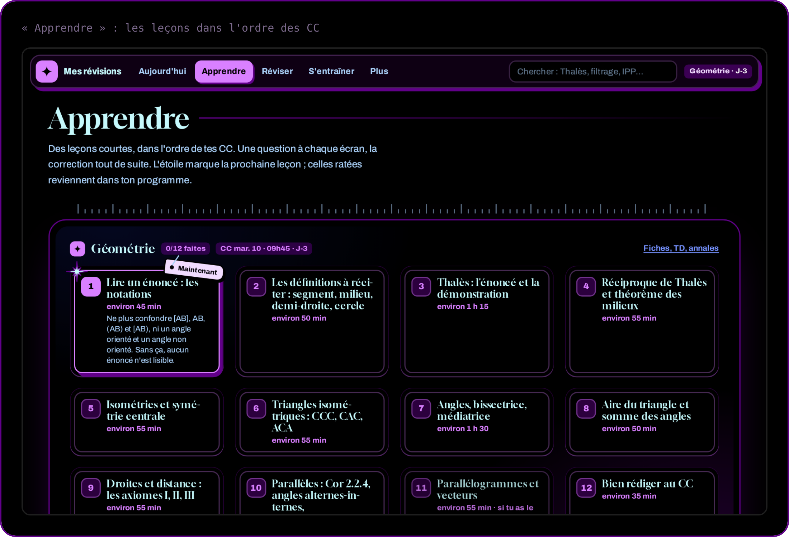

<a href="https://glime32.github.io/revisions-s1/"><b>Ouvrir le site</b></a> · <a href="#english">English</a>

Mon site de révisions pour les contrôles continus du semestre 1 de la double licence maths-info à l'Université de Montpellier : **géométrie, algorithmique, programmation fonctionnelle (OCaml) et calculus**.

## Ce qu'il y a dedans

- **38 leçons courtes**, dans l'ordre des CC : une notion par écran, une question à chaque étape, la correction tout de suite. Une leçon ne demande jamais quelque chose qu'elle n'a pas encore montré.
- **Révision espacée** : les questions ratées reviennent en cartes, au bon moment.
- **Programme du jour** recalculé à chaque leçon terminée : séances de moins de 2 h avec pauses, temps partagé entre les matières selon le poids des CC et la date du prochain, durées ajustées à ma vitesse réelle.
- **Fiches A4** recto-verso en PDF (algo, OCaml), TD et annales par matière.
- **Recherche** (« Thalès », « filtrage », « IPP »…).
- Marche **hors ligne** et s'installe comme une appli sur le téléphone. La progression peut se synchroniser entre appareils par un gist GitHub privé.

## English

A revision site for my first-semester exams (maths & computer science, University of Montpellier): 38 short step-by-step lessons, spaced-repetition cards, a daily plan recomputed after each lesson, printable A4 sheets. Works offline and installs as a phone app. In French.
